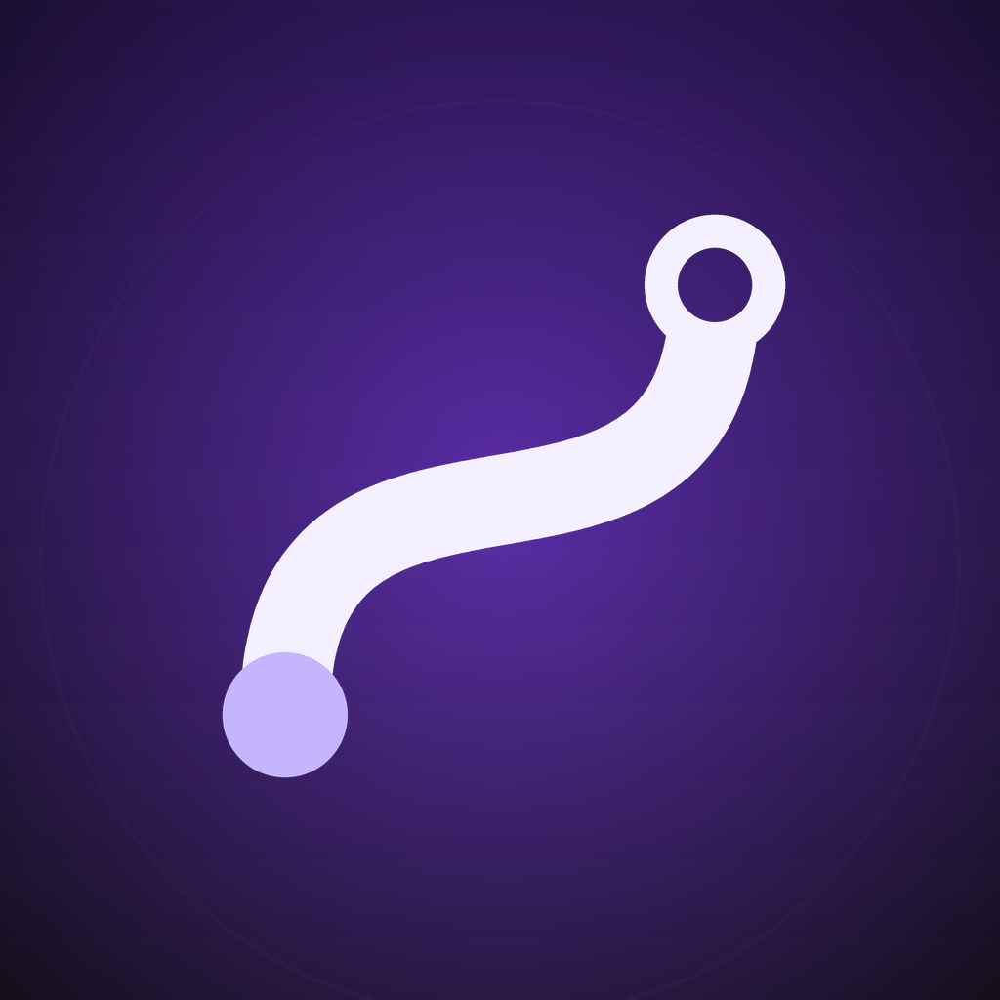

# TailTide

A private Tailscale client for HarmonyOS, with an optional built-in Shadowsocks egress for the Tailscale control plane / DERP.

> **Not affiliated with Tailscale Inc.** "Tailscale" is used only to describe interoperability.
>
> **Not affiliated with JJ Lin.** The purple palette is only inspired by the fan support color "紫海"; no endorsement is implied.

## Features

- HarmonyOS 5/6/7 (API 24+), ArkTS UI + VpnExtensionAbility + Go/tsnet engine.
- Explicit Tailscale TUN route `100.64.0.0/10` (no global proxy, normal traffic unaffected).
- Built-in minimal classic Shadowsocks AEAD client (aes-128/256-gcm, no plugin).
- Import Clash YAML, choose a primary node, automatic fallback to the remaining candidates.
- Stable local front proxy `127.0.0.1:7899`; upstream can be direct, an external HTTP(S) proxy, or SS.
- Connection state from the engine heartbeat; no false "connected" state after install/restart.
- Light/dark theme, status card, egress card, advanced settings, IP copy, toast/dialog feedback.
- No telemetry.

## Architecture

See [docs/ARCHITECTURE.md](docs/ARCHITECTURE.md).

## Build

See [docs/BUILD.md](docs/BUILD.md). `third_party/` is **not** vendored in this repo; follow the build doc to prepare the Go toolchain, Tailscale source and patches.

## Privacy

No telemetry, no analytics. SS node configuration is stored in the app sandbox. See [PRIVACY.md](PRIVACY.md).

## Security

See [SECURITY.md](SECURITY.md). Never commit `.cache/`, `clash-config.yaml` or `ss-node.json`.

## License

MIT. See [LICENSE](LICENSE).

## Third-party

See [THIRD_PARTY_NOTICES.md](THIRD_PARTY_NOTICES.md).

## Disclaimer

This is a personal project, provided "as is", without warranty. You are responsible for complying with Tailscale's terms and your Shadowsocks provider's terms. The built-in SS client is only used for the Tailscale control plane/DERP, not as a global proxy.
